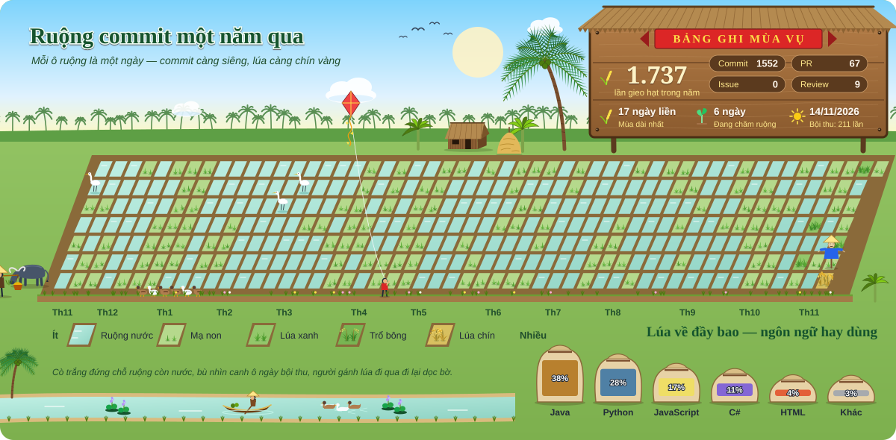

  

    

  <h1>Nguyen Ngoc Thien</h1>

  
<em>Người con xứ dừa Bến Tre, lên Sài Gòn học nghề viết phần mềm</em>

  
<strong>Software Engineering Student @ HCMUTE • Full-Stack Developer • ML Enthusiast</strong>

  

  

    
    
    
    
  

   

  

## 🥥 Đôi dòng làm quen

> Mình lớn lên ở xứ dừa Bến Tre, nơi kênh rạch chằng chịt, đi đâu cũng phải qua cầu khỉ hay bơi xuồng.
> Giờ mình học Kỹ thuật Phần mềm ở HCMUTE, nhưng cách làm việc thì vẫn giữ nết người miền Tây:
> **làm cái gì cũng chắc tay, xài được lâu, và chừa chỗ cho người tới sau dễ sửa.**

  

  

## 🛶 Đồ nghề trên ghe

<em>Người miền Tây đi ghe thì phải đủ dầm, chèo, lưới. Còn đây là đồ nghề mình mang theo mỗi chuyến code:</em>

  <strong> Mái dầm — Ngôn ngữ chính</strong> 
  
  
  
  

  <strong> Thân ghe — Backend & kiến trúc hệ thống</strong> 
  
  
  
  

  <strong> Mui ghe — Frontend & giao diện</strong> 
  
  
  
  

  <strong> Khoang chứa — Database & DevOps</strong> 
  
  
  
  

  <strong> Tay lưới — AI & Machine Learning</strong> 
  
  
  

  

## 🌾 Mấy mùa vụ đã gặt

<em>Mỗi dự án như một mùa vụ: có lúc nắng, lúc mưa, nhưng gặt về rồi là thấy thương.</em>

<table>
  <tr>
    <td width="50%" valign="top">
      <h3> CineBook — Đặt vé xem phim</h3>
      
<em>🛶 Chuyện kể: Bến đò chiều 30 Tết, ai cũng giành lên đò cho kịp về nhà. Bài toán ở đây là làm sao hai người không ngồi chung một ghế.</em>

      
Nền tảng đặt vé rạp phim, chịu được <strong>nhiều người giành cùng một ghế một lúc</strong> nhờ <strong>khóa phân tán Redis Redlock</strong>, có thêm chatbot AI trả lời khách.

      

        
        
        
      

      

        
        
      

    </td>
    <td width="50%" valign="top">
      <h3> MayVang — Đặt phòng khách sạn</h3>
      
<em>🏡 Chuyện kể: Nhà vườn miền Tây hay tách nhà trên tiếp khách với nhà sau nấu bếp. Mỗi bên lo việc của mình, mà vẫn chung một mái nhà.</em>

      
Hệ thống đặt phòng và quản lý khách sạn full-stack, <strong>tách riêng backend Java Spring Boot và frontend</strong> để mỗi phần phát triển, sửa chữa độc lập.

      

        
        
        
      

      

        
        
      

    </td>
  </tr>

  <tr>
    <td width="50%" valign="top">
      <h3> Sentiment Analysis — Đọc vị cảm xúc</h3>
      
<em>💬 Chuyện kể: Má nghe giọng con qua điện thoại là biết con đang vui hay buồn. Mô hình này tập làm điều đó, mà là với câu chữ.</em>

      
Hệ thống machine learning phân loại cảm xúc văn bản, làm trọn từ <strong>tiền xử lý dữ liệu, trích xuất đặc trưng, đánh giá mô hình</strong> tới <strong>API suy luận tách riêng</strong>.

      

        
        
        
      

      

        
        
      

    </td>
    <td width="50%" valign="top">
      <h3> Caro AI — Cờ caro dưới gốc dừa</h3>
      
<em>🌴 Chuyện kể: Hồi nhỏ ngồi gốc dừa đánh caro với tụi nhỏ trong xóm, đứa nào tính trước được vài nước là thắng. Giờ mình dạy máy làm y vậy.</em>

      
Tác tử chơi Gomoku (Caro) trên bàn cờ NxN, dùng <strong>tìm kiếm heuristic</strong> và <strong>cắt tỉa Alpha-Beta</strong> để ra quyết định theo thời gian thực.

      

        
        
      

      

        
        
      

    </td>
  </tr>
</table>

### 🏺 Mấy món nhỏ cất trong lu

  

| Dự án | Đồ nghề | Có gì hay | Ghé xem |
| :--- | :--- | :--- | :--- |
| **Folder Locker** | `C#` `.NET` | Khóa và mã hóa thư mục trên máy, giữ đồ riêng cho kỹ | [Ghé xem →](https://github.com/Thien21112005/folder-locker) |
| **VietTech E-commerce** | `Web Tech` `JavaScript` | Cửa hàng online đủ vòng: danh mục, giỏ hàng, đặt mua | [Ghé xem →](https://github.com/Thien21112005/viettech-ecommerce) |
| **TickTick App Clone** | `Java` `Desktop` | Ghi việc cần làm và theo dõi thói quen mỗi ngày | [Ghé xem →](https://github.com/Thien21112005/ticktick-app) |
| **Calculator App** | `Java` `UI` | Máy tính nhiều chế độ, nhỏ mà có võ | [Ghé xem →](https://github.com/Thien21112005/calculator-app) |

  

## 📒 Sổ tay ghi chép mùa màng

<em>Nhà nông có cuốn sổ ghi mùa màng, dân code thì có mấy tấm biểu đồ này:</em>

  

 

  
<em>🐍 Con rắn bò dọc bờ ruộng commit</em>

  <picture>
    <source media="(prefers-color-scheme: dark)" srcset="https://raw.githubusercontent.com/Thien21112005/Thien21112005/output/github-contribution-grid-snake-dark.svg">
    <source media="(prefers-color-scheme: light)" srcset="https://raw.githubusercontent.com/Thien21112005/Thien21112005/output/github-contribution-grid-snake.svg">
    
  </picture>

  
<em>🌾 Ruộng commit: mỗi ô là một ngày, lúa tự lớn theo số commit (vẽ lại mỗi ngày)</em>

  

   
  
  
<em>Code đều tay như chèo xuồng: chậm mà chắc, đi hoài cũng tới.</em>

   
  

